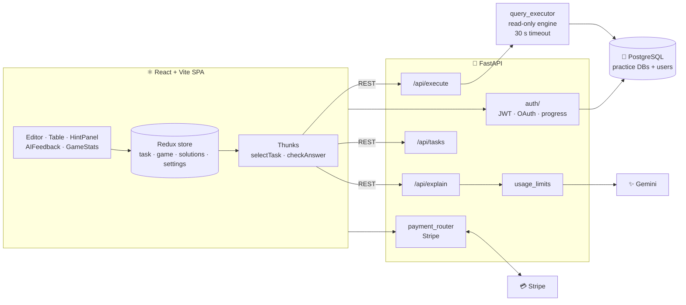
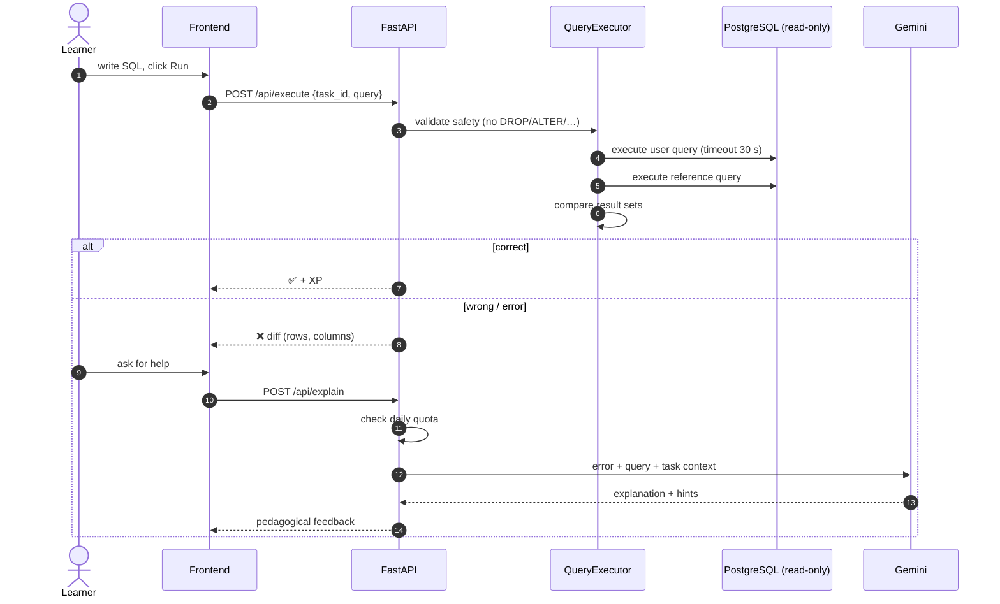
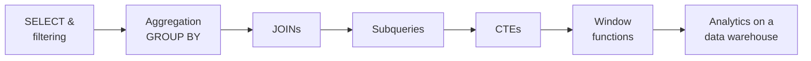

<div align="center">

# 🎓 SQL4Data — Learn SQL by Solving Real Data Problems

**Interactive SQL training platform: 100+ graded exercises on realistic databases, AI explanations of your mistakes, XP progression and a freemium model.**

[](https://react.dev/)
[](https://vitejs.dev/)
[](https://redux-toolkit.js.org/)
[](https://fastapi.tiangolo.com/)
[](https://www.postgresql.org/)
[](https://ai.google.dev/)
[](https://stripe.com/)
[](https://storybook.js.org/)
[](LICENSE)

</div>

---

## 📌 Table of contents

- [Overview](#-overview)
- [Features](#-features)
- [Architecture](#-architecture)
- [How a query is graded](#-how-a-query-is-graded)
- [Learning path](#-learning-path)
- [API](#-api)
- [Quick start](#-quick-start)
- [Project structure](#-project-structure)
- [Credits & license](#-credits--license)

---

## 🎯 Overview

SQL4Data targets aspiring **data analysts, data engineers and data scientists**. Each exercise is a business question on a realistic database; your query is executed and its **result set is compared with a reference solution**. When it fails, an LLM explains *why* — pedagogically, without giving away the answer.

---

## ✨ Features

| | Feature |
|---|---|
| 🧩 | **115 tasks** — SELECT → JOIN → subqueries → CTEs → window functions → analytics |
| 🗄️ | **Realistic datasets** — music store, e-commerce, accounting, data warehouse (star schema) |
| ✅ | **Result-set grading** — order-aware comparison against a gold query |
| 🤖 | **AI feedback** — Gemini explains errors and suggests next steps, with deterministic fallback |
| 💡 | **Hint engine** — progressive hints generated per task |
| 🎮 | **Gamification** — XP, levels, task unlocking, progress sync across devices |
| 🔐 | **Auth** — JWT + Google / GitHub OAuth |
| 💎 | **Freemium** — daily limits for free users, Stripe Checkout + Customer Portal for Premium |
| 🌍 | **4 languages** — English · Français · العربية · Русский; light / dark theme |

| | Free | Premium |
|---|:---:|:---:|
| AI feedback | 3 / day | 50 / day |
| Hints | 3 / day | unlimited |
| All exercises | — | ✅ |
| Solution viewer | — | ✅ |

---

## 🏗️ Architecture



---

## 🔍 How a query is graded



**Safety:** queries run on a dedicated read-only engine with a statement timeout and a deny-list of DDL/DML keywords.

---

## 🗺️ Learning path



---

## 🔌 API

| Method | Endpoint | Purpose |
|---|---|---|
| `GET` | `/health` | Status |
| `GET` | `/api/tasks` · `/api/tasks/{id}` | Task catalogue |
| `POST` | `/api/execute` | Run + grade a query |
| `POST` | `/api/explain` | AI explanation of an error |
| `POST` | `/create-checkout-session` · `/create-portal-session` | Stripe billing |
| `POST` | `/webhook` | Stripe events |
| `GET` | `/subscription-status` | Current plan |

---

## 🚀 Quick start

```bash
git clone https://github.com/mohamedabi17/SQL4Data.git
cd SQL4Data

# Backend
cd backend
python -m venv venv && source venv/bin/activate
pip install -r requirements.txt
cp .env.example .env               # DATABASE_URL, GEMINI_API_KEY, JWT, OAuth, Stripe keys
uvicorn main:app --reload --port 8001

# Frontend
cd ..
npm install
npm run dev                        # http://localhost:5173
```

Component workshop: `npm run storybook`.

---

## 📁 Project structure

```
.
├── src/
│   ├── blocks/ · components/    # Feature blocks + reusable UI (Storybook stories)
│   ├── store/                   # Redux: reducers, thunks, listener middleware
│   ├── assets/databases/        # music · ecommerce · accounting · datawarehouse
│   ├── assets/tasks/tasks.ts    # Exercise catalogue
│   ├── utils/hintGenerator.ts
│   └── i18n/resources/          # en · fr · ar · ru
├── backend/
│   ├── main.py                  # FastAPI app
│   ├── query_executor.py        # Safe execution + result comparison
│   ├── ai_explainer.py          # Gemini explanations
│   ├── usage_limits.py          # Free / Premium quotas
│   ├── payment_router.py · stripe_integration.py
│   └── auth/                    # JWT, OAuth, progress, ads
└── .storybook/
```

---

## 🙏 Credits & license

SQL4Data extends the open-source **sql-trainer** project by [iDeBugger](https://github.com/iDeBugger/sql-trainer) with a FastAPI backend, AI feedback, accounts, payments and new datasets.
Distributed under the **GNU AGPL v3** — see [LICENSE](LICENSE).

---

<div align="center">

**Mohamed Abi** · [GitHub @mohamedabi17](https://github.com/mohamedabi17)

</div>
